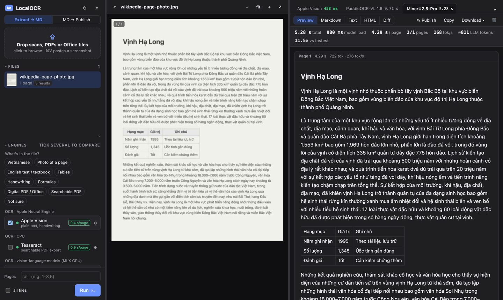
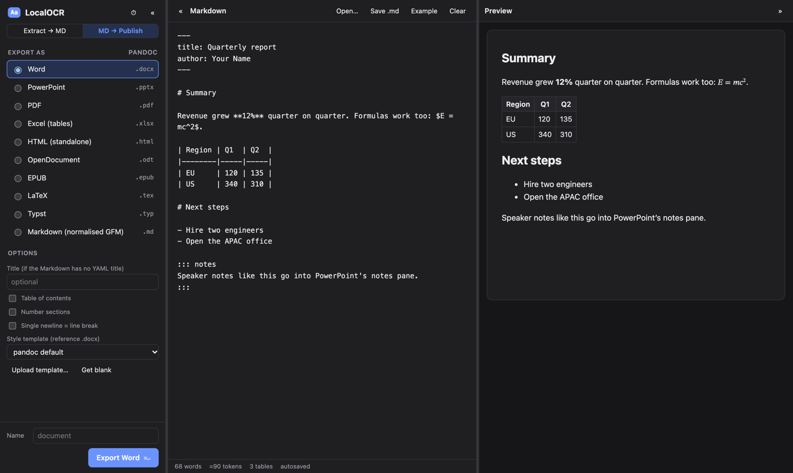

# LocalOCR

Local, token-saving document workbench for Apple Silicon. It has two modes:

- **Extract → MD**: turn scans, PDFs and Office files into lean Markdown you can paste into an LLM. OCR engines and converters run side by side with timings and an approximate token count.
- **MD → Publish**: write or paste Markdown (for example LLM output) and export Word, PowerPoint, PDF, Excel and more via pandoc. Optional Word/PowerPoint style templates.





## Install

macOS on Apple Silicon only (Apple Vision, MLX and Quick Look). Everything runs locally; nothing is uploaded.

```sh
brew install uv                                   # required; Xcode Command Line Tools provide swiftc
brew install tesseract tesseract-lang pandoc llama.cpp   # optional: Tesseract, pandoc, marker on scans
git clone https://github.com/DungMinhDao/LocalOCR.git && cd LocalOCR
./start.sh            # opens http://127.0.0.1:8765  (--port N, --no-browser)
```

The first start creates the Python environment and compiles the Apple Vision helper into `bin/`. Each model is downloaded from Hugging Face the first time you run it (about 1–3 GB per model). Uploads, results and templates live in `data/`; set `LOCALOCR_DATA` to put them elsewhere.

## Command line (for agents and scripts)

```sh
ln -s "$PWD/localocr-cli" ~/.local/bin/localocr      # once; any directory on your PATH works

localocr extract scan.jpg                        # Markdown on stdout, progress on stderr
localocr extract paper.pdf -e glm-ocr -p 1-3     # pick an engine and pages
localocr extract *.pdf -o md/                    # several files → one .md each
localocr extract scan.jpg -e tesseract --opt dpi=300 -f json   # engine options; json includes timings
localocr engines -v                              # engine ids and their --opt keys

localocr publish notes.md -t pptx --template brand.pptx   # → notes.pptx
llm-tool | localocr publish - -t docx -o report.docx
```

`extract` uses the running server when it is up (models stay warm; set `LOCALOCR_URL` or `--server`), otherwise it runs the engine in-process (`--local` forces this). The default engine `auto` picks MarkItDown for Office files, the PDF text layer for digital PDFs, and Apple Vision for scans and images. CLI runs don't appear in the GUI history unless you pass `--keep`. `publish` always runs pandoc directly; `--template` takes a reference .docx/.pptx/.odt path or the name of a template uploaded in the GUI.

## Engines

| Engine | Runs on | Notes |
|---|---|---|
| Apple Vision | Neural Engine | 0.4 s/page. Good on handwriting and Vietnamese; weak on multi-column reading order and formulas |
| Tesseract | CPU, pages in parallel | 0.9 s/page. Only exporter for searchable PDFs |
| PaddleOCR-VL 1.6, MinerU2.5-Pro, Unlimited-OCR-2, Xiaomi-OCR-0, TeleOCR | GPU via MLX (`mlx-vlm`) | The five featured vision-language models, chosen for Vietnamese documents, photographed pages and English tests at under 9 s/page (see Benchmark). Others (LightOnOCR-3 1B/4B, GLM-OCR, OvisOCR2, dots.mocr) sit under **More models**, plus any mlx-vlm model id via *Custom* |
| marker-pdf 2.1 | MPS + llama.cpp/Metal | Layout, tables, and reuses the PDF text layer. Best on degraded scans, ~14 s/page |
| PDF text layer | CPU | Instant, but only works on digital PDFs |
| MarkItDown 0.1.9 (Microsoft) | CPU | DOCX/PPTX/XLSX/XLS/MSG/HTML/EPUB/PDF text. The leanest Markdown, and the best choice for spreadsheets. Optional OCR of embedded images via a local MLX model (`markitdown-ocr`) |
| pandoc 3 | CPU | DOCX/PPTX/ODT/RTF/EPUB/HTML/LaTeX/ipynb. The highest fidelity (footnotes, complex tables), and round-trips with Publish |

**Two ways to read a page.** Whole-page models (Unlimited-OCR-2, Xiaomi-OCR-0, LightOnOCR-3, OvisOCR2, dots.mocr…) read the page in one pass. Block models (PaddleOCR-VL, GLM-OCR, MinerU, TeleOCR) were trained to read one region at a time: in *Layout blocks* mode PP-DocLayoutV3 finds the text blocks, tables and formulas in reading order (~0.1 s), and the model reads each crop with the matching prompt. Headers, footers, page numbers and pictures are skipped. On whole pages these models lose tables and formulas, so block mode is their default.

The VLMs and marker run in their own worker processes (`workers/*.py`, with dependencies declared inline and run via `uv run --script`). This keeps their dependencies isolated, and the models stay warm. **Unload** in an engine's ⚙ panel frees the memory. Up to 2 MLX models stay loaded (`LOCALOCR_MLX_MAX_MODELS`). LightOnOCR-3's community MLX conversions are broken, so the worker quantises LightOn's official weights into `data/models/` on first use.

**Speed tip:** for VLMs, most of the time goes to prefilling the image tokens. The *Max image side* option (default 1280 px) is the biggest speed lever.

## Which engine for what

You don't need to remember these: in the app, **What's in the file?** above the engine list ticks the right engine for a kind of document and names the alternatives, and every engine shows what it is good for under its name.

- **Default:** PaddleOCR-VL 1.6 (block mode): the fastest of the accurate models (4.1 s/page) and good at everything below.
- **Vietnamese documents:** MinerU2.5-Pro or Unlimited-OCR-2. Avoid Xiaomi-OCR-0 and TeleOCR, which drop diacritics.
- **Photos of documents:** PaddleOCR-VL or Unlimited-OCR-2 (marker is better still but takes ~14 s/page).
- **English tests, textbooks and their tables:** TeleOCR (most accurate) or Xiaomi-OCR-0 (fastest).
- **Handwriting:** Apple Vision (instant); LightOnOCR-3 4B for Vietnamese handwriting if time doesn't matter. **Formulas:** every model scores 56–69, so check the output; PaddleOCR-VL or GLM-OCR.
- **Digital PDFs:** PDF text layer (instant) or marker. **Office files:** MarkItDown (fewest tokens) or pandoc (highest fidelity).

## Benchmark

`bench/` measures accuracy and speed on 122 samples with ground truth: English OmniDocBench pages (tables, formulas, multi-column, slides, handwritten notes, exam papers, textbooks), the same pages scanned/warped/photographed/badly lit/skewed (Real5-OmniDocBench) or shrunk to ~40 %, typeset Vietnamese pages (clean and degraded), Vietnamese handwriting and printed lines, and English handwriting (IAM).

```sh
uv run --with pandas --with pyarrow python -m bench.fetch          # download the samples (~100 MB)
./start.sh --no-browser &
uv run --with rapidfuzz --with apted --with lxml python -m bench.run apple-vision paddleocr-vl lighton-ocr-3-1b …
uv run --with rapidfuzz --with apted --with lxml python -m bench.report   # → bench/report.html (interactive)
```

`bench/report.html` is interactive: pick a use case (*My mix* = the average of Vietnamese, photos of pages and English tests; or one of those; or *All tasks*, which adds handwriting and formulas) and a speed limit (a slider), and the chart, ranking, per-task heatmap and recommendations follow. Each model has a short card on what it is good and bad at.

By use case (s/page = median warm time on full pages; M3 Max, Nov 2026). *My mix* is the mean of Vietnamese, Photos of pages and English tests; *All tasks* also counts handwriting and formulas. Chandra OCR 2 was benchmarked and then removed from the app (28 s/page, 3.6 GB).

| Engine | My mix | Vietnamese | Photos of pages | English tests | All tasks | s/page |
|---|---|---|---|---|---|---|
| marker | **91.6** | 95.5 | **93.2** | 86.1 | 81.7 | 14.4 |
| LightOnOCR-3 4B | 90.8 | **98.8** | 88.5 | 85.1 | 82.3 | 15.2 |
| Unlimited-OCR-2 | 90.5 | 93.3 | 88.7 | 89.4 | 75.2 | 8.0 |
| MinerU2.5-Pro (blocks) | 90.1 | 94.8 | 87.4 | 88.1 | 81.7 | 6.5 |
| PaddleOCR-VL 1.6 (blocks) | 89.9 | 91.0 | 89.3 | 89.4 | **83.3** | 4.1 |
| LightOnOCR-3 1B | 89.3 | 96.2 | 88.8 | 82.8 | 83.0 | 8.8 |
| GLM-OCR (blocks) | 85.4 | 83.1 | 85.1 | 87.9 | 80.3 | 6.0 |
| OvisOCR2 | 84.3 | 84.8 | 83.2 | 85.0 | 77.6 | 5.4 |
| Xiaomi-OCR-0 | 83.9 | 79.7 | 81.7 | 90.4 | 79.8 | 5.0 |
| Chandra OCR 2 (removed) | 83.8 | 98.3 | 76.8 | 76.4 | 79.6 | 28.4 |
| dots.mocr | 82.4 | 93.1 | 66.3 | 87.8 | 78.0 | 8.8 |
| TeleOCR (blocks) | 77.9 | 61.5 | 79.8 | **92.3** | 75.2 | 7.7 |
| Apple Vision | 69.0 | 91.6 | 53.1 | 62.4 | 53.8 | **0.43** |
| Tesseract (eng/vie) | 55.7 | 71.3 | 41.3 | 54.4 | 33.9 | 0.88 |

Within 9 s/page, Unlimited-OCR-2, MinerU2.5-Pro and PaddleOCR-VL are tied on *My mix* (90.5 / 90.1 / 89.9; the bootstrap 95 % interval is about ±3.5 points), so PaddleOCR-VL, the fastest, is the default. The specialists win their own column: MinerU (and LightOnOCR-3) on Vietnamese, TeleOCR and Xiaomi-OCR-0 on English tests. marker and LightOnOCR-3 4B are more accurate still, but take 14–15 s/page.

## Publish

Formats: Word, PowerPoint (one slide per heading; `::: notes` blocks become speaker notes), PDF (Typst if installed, otherwise headless Chrome), Excel (each Markdown table becomes a sheet), HTML, ODT, EPUB, LaTeX, Typst, and normalised GFM.

For your own look, click **Get blank** to download pandoc's reference .docx/.pptx, restyle it in Word or PowerPoint, then upload it as a template. **✎ Publish** on any Extract result opens it in the editor.

## Features

- Drop or paste (⌘V) PDFs, PNG/JPEG/HEIC/TIFF/WebP files, multi-frame TIFFs, and Office/HTML/EPUB files (MarkItDown only; previews come from Quick Look); choose a page range; run on all files at once
- Tick several engines to compare them: one tab per run, the fastest one in green, ×-slower ratio, and per-page tokens/s plus prefill stats
- Views: rendered Markdown (tables and math), raw Markdown, plain text, HTML, and a **word diff** between two engines with a % similarity score
- Click a page on either side to jump to the same page on the other side
- Select and copy text in the original: digital PDFs use their own text layer, scans and images get an invisible Apple Vision layer (Live Text-style). Office files show as HTML (Quick Look for Word/PowerPoint/Excel, pandoc for ODT/RTF/EPUB/ipynb/LaTeX). CSV files and large workbooks show every row and sheet in a grid, because Quick Look stops at about 4,000 rows
- Resizable panes: drag a splitter to resize, double-click it to collapse, and click a collapsed bar to reopen. Sidebar sections fold, and ⌘\ toggles the sidebar
- Export to MD, TXT, HTML, DOCX, or JSON (with timings), a searchable PDF (Tesseract), or a zip of every result for a file
- Benchmarks table of every finished run (sortable); history is kept in `data/`
- Stop a run mid-generation; loops where a VLM repeats itself are stopped automatically

Data lives in `data/` (uploads and results); delete it to reset.

## License

MIT, see [LICENSE](LICENSE). The models and tools it downloads keep their own licences: the featured models are Apache-2.0 or MIT, while marker-pdf is GPL-3.0 and its model weights restrict commercial use. Check the model card before using a model commercially.
